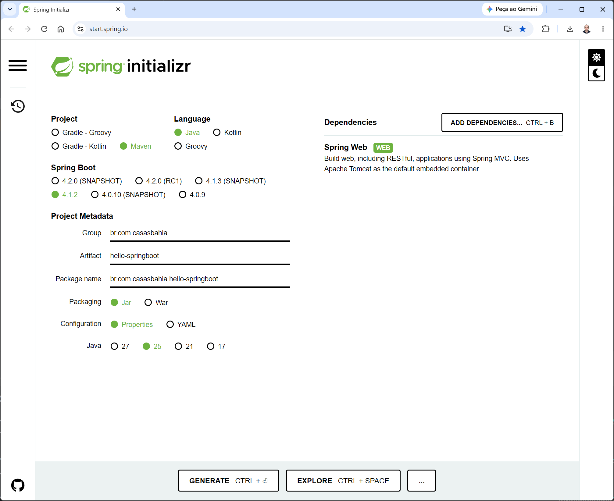
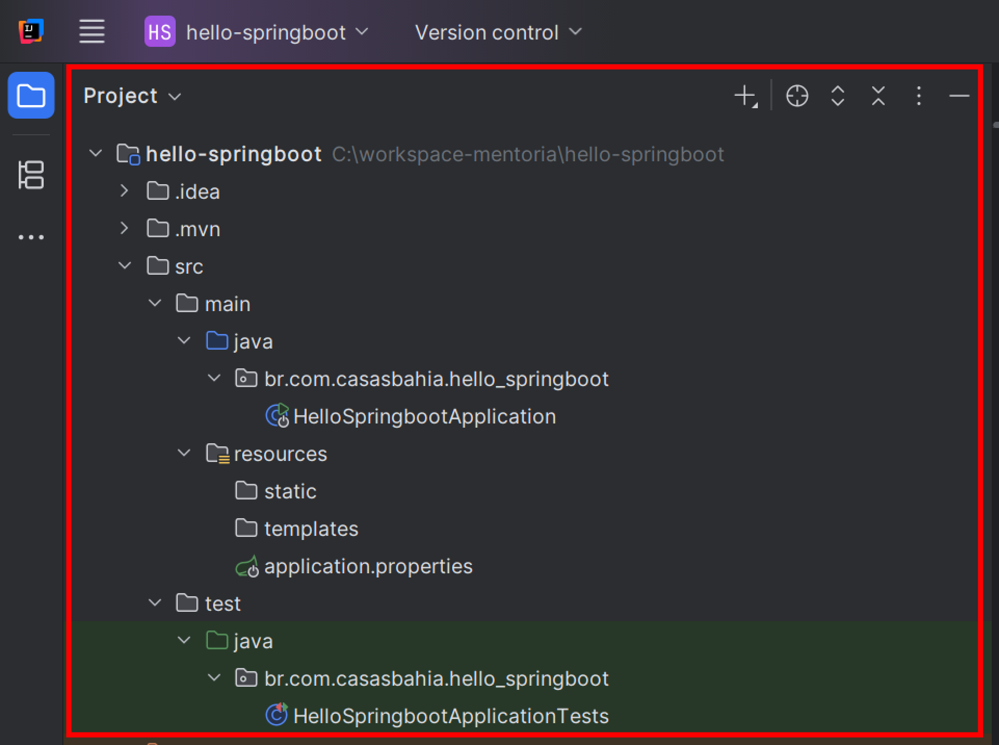
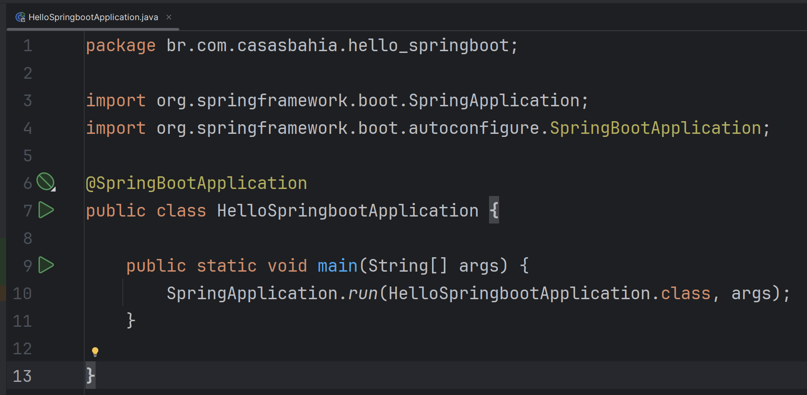
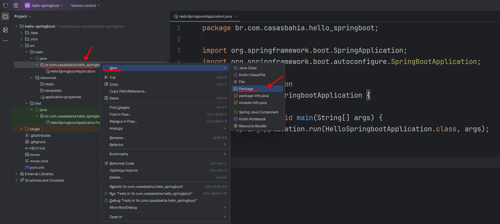
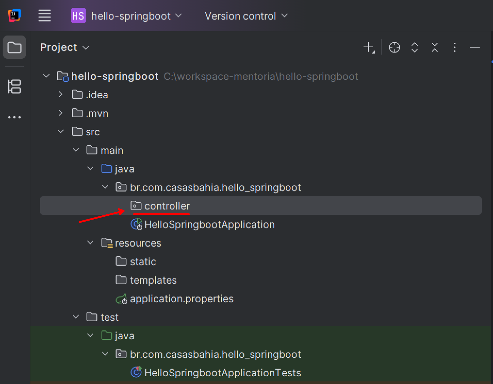
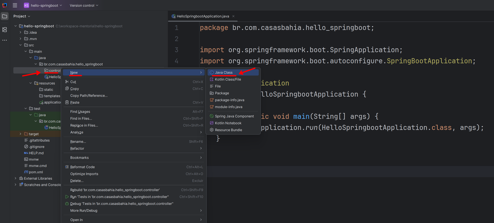
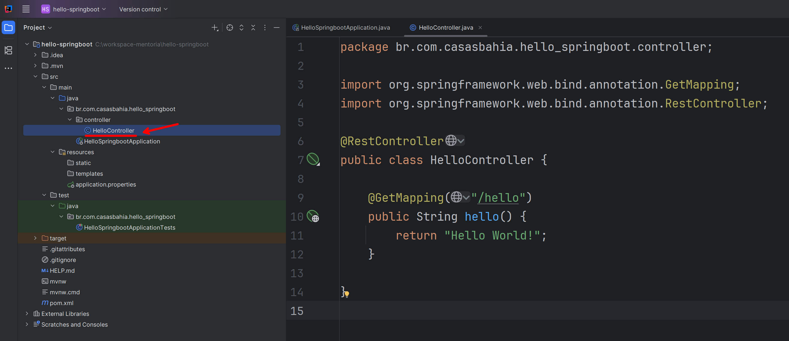
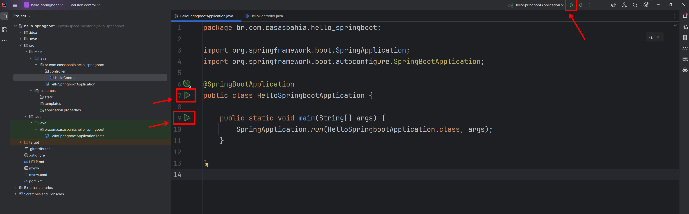
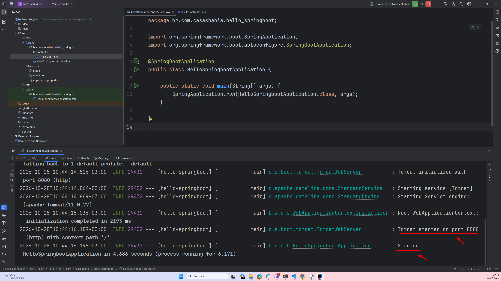
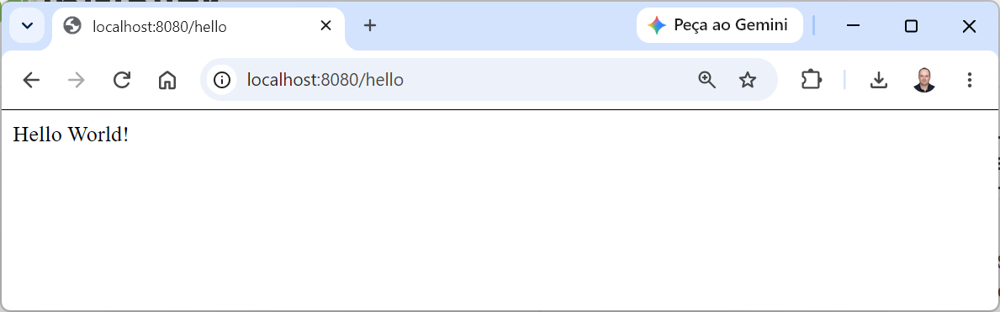

# 🍃 Primeira aplicação com Spring Boot

### Java 25 • Spring Initializr • IntelliJ IDEA

Uma aula prática para quem está tendo o primeiro contato com Spring Boot e quer criar, executar e consumir uma aplicação web.

> 🎯 **Objetivo:** sair do projeto inicial até uma aplicação que responde a requisições HTTP, entendendo o papel das principais ferramentas e anotações.

## 🧭 Como a aula está organizada

| Parte | O que você vai aprender |
| --- | --- |
| 📚 **1. Introdução teórica** | Spring, Spring Boot, Spring Initializr e anotações. |
| 🛠️ **2. Criando a aplicação** | Gerar o projeto, abrir no IntelliJ, criar um controller e executar. |
| 🌐 **3. Consumindo a aplicação** | Acessar endpoints, entender HTTP e enviar parâmetros pela URL. |
| 🧩 **4. Estudo complementar** | Praticar com novas rotas e pequenas alterações. |

### Antes de começar

- Conheça o básico de classes, métodos, parâmetros, retorno e pacotes em Java.
- Utilize um ambiente de aula com **IntelliJ IDEA e JDK 25 já preparados**.
- Tenha acesso à internet para gerar o projeto e carregar as dependências.

> 💡 Esta aula começa com o ambiente disponibilizado pela IDE do IntelliJ. Instalação do Java, variáveis de ambiente e execução por terminal serão abordadas em um material e aula específica.

---

# 📚 Parte 1 — Introdução teórica

## 1.1. O que é Spring Framework?

O **Spring Framework** é um framework Java que oferece uma base para desenvolver aplicações. Ele possui recursos para organizar componentes, gerenciar objetos e atender requisições web, entre outras tarefas.

Um framework fornece uma estrutura que participa da execução do seu código. Nesta aula, você escreverá um método Java e o Spring será responsável por chamá-lo quando uma requisição correspondente chegar.

> 🔎 **Exemplo:** quando alguém acessar `/hello`, o Spring encontrará o método associado a esse caminho e utilizará seu retorno para produzir uma resposta.

## 1.2. O que é Spring Boot?

O **Spring Boot** facilita a criação e a execução de aplicações baseadas no Spring. Ele oferece convenções e configuração automática para reduzir o trabalho necessário para começar.

| Recurso | O que significa na prática |
| --- | --- |
| ⚙️ **Configuração automática** | Prepara recursos considerando as dependências e as configurações da aplicação. |
| 📦 **Starters** | Reúnem dependências voltadas a uma finalidade, como desenvolvimento web. |
| 🚀 **Servidor embutido** | Permite executar nossa aplicação web sem instalar um servidor separadamente. |

Uma **dependência** é uma biblioteca utilizada pelo projeto. Ao escolher o suporte web, adicionamos as bibliotecas necessárias para criar controllers e atender HTTP.

Neste projeto, usaremos o servidor **Tomcat**, iniciado junto com a aplicação.

> 💡 Spring Boot também pode ser usado em aplicações que não são web. Aqui, o servidor será iniciado porque escolhemos o suporte web.

## 1.3. O que é Spring Initializr?

O **Spring Initializr** é uma ferramenta para gerar a estrutura inicial de projetos Spring Boot.

No site [start.spring.io](https://start.spring.io), escolhemos as características do projeto e baixamos um arquivo ZIP pronto para abrir no IntelliJ.

Ele gera a base do projeto, mas as funcionalidades serão desenvolvidas por nós. O Initializr também não hospeda a aplicação: nesta aula, ela será executada no seu computador.

### 🧰 Qual é o papel de cada ferramenta?

| Ferramenta | Responsabilidade |
| --- | --- |
| **Spring Framework** | Fornecer a base e os recursos utilizados pela aplicação. |
| **Spring Boot** | Facilitar a configuração e a inicialização da aplicação Spring. |
| **Spring Initializr** | Gerar a estrutura inicial do projeto. |
| **IntelliJ IDEA** | Permitir escrever, organizar e executar o código. |
| **Maven** | Gerenciar dependências e tarefas de construção; será integrado pelo IntelliJ. |
| **Tomcat** | Receber as conexões HTTP da aplicação web. |

## 1.4. O que são anotações em Java?

**Anotações são metadados escritos com `@`**, associados a elementos do código, como classes, métodos e parâmetros.

Elas não são comentários. Dependendo de sua definição, podem ser interpretadas pelo compilador, por ferramentas ou por frameworks.

Por exemplo:

```java
@GetMapping("/hello")
public String hello() {
    return "Hello World!";
}
```

Nesse trecho:

- `@GetMapping` é uma anotação interpretada pelo Spring.
- `"/hello"` é o caminho associado ao método.
- `hello()` é o método Java que será chamado para atender a requisição GET correspondente.
- `return` fornece o conteúdo que será utilizado na resposta.

A anotação configura **como o Spring relaciona a requisição ao código**. A lógica da mensagem continua sendo escrita em Java.

### 🏷️ Anotações que usaremos

| Anotação | Onde aparece | Para que serve |
| --- | --- | --- |
| `@SpringBootApplication` | Classe principal | Reúne recursos de configuração e descoberta de componentes. |
| `@RestController` | Classe do controller | Identifica um controller e permite escrever os retornos no corpo da resposta. |
| `@GetMapping` | Método | Associa uma requisição GET a um método Java. |
| `@RequestParam` | Parâmetro do método | Recebe um parâmetro enviado na requisição. |

> 📌 **Import não é anotação:** o `import` permite usar o nome simples de um tipo no arquivo. Importar `GetMapping` não cria uma rota; aplicar `@GetMapping` ao método configura o mapeamento.

---

# 🛠️ Parte 2 — Passo a passo: criando a aplicação

## 2.1. Gerando o projeto no Spring Initializr

### ① Acesse o site

Abra [https://start.spring.io](https://start.spring.io).

### ② Preencha os dados

| Campo | Valor para a aula | O que representa |
| --- | --- | --- |
| **Project** | `Maven` | Ferramenta que organiza dependências e construção. |
| **Language** | `Java` | Linguagem utilizada no projeto. |
| **Spring Boot** | Versão estável da linha `4.1.x`, compatível com Java 25 | Versão do Spring Boot. |
| **Group** | `br.com.casasbahia` | Identificação organizacional. |
| **Artifact** | `hello-springboot` | Identificador do projeto. |
| **Package name** | `br.com.casasbahia.hellospringboot` | Pacote base das classes Java. |
| **Packaging** | `Jar` | Formato de empacotamento da aplicação. |
| **Configuration File Format** | `properties` | Formato do arquivo de configuração do Spring Boot. |
| **Java** | `25` | Versão Java adotada na aula. |

> 📌 **Sobre a versão do Spring Boot:** a documentação consultada para esta revisão apresenta `4.1.2` como estável e compatível com Java 25. As opções do Initializr mudam. Utilize a versão estável compatível definida pelo instrutor para a turma; evite opções com `SNAPSHOT`, `M` ou `RC`.

> 🔎 **Atenção ao pacote:** o nome do projeto usa hífen, mas o pacote dos exemplos é `br.com.casasbahia.hellospringboot`, sem hífen e sem sublinhado. Preencha esse campo explicitamente.

### ③ Adicione a dependência web

Clique em **Add Dependencies** e selecione **Spring Web**, ou a opção equivalente de aplicações web com **Spring MVC e Tomcat** na versão escolhida.

Essa dependência fornece a base para criar os endpoints desta aula. Mantenha as dependências geradas pelo Initializr para a versão selecionada.


Segue o link do Spring Initializr preenchido: [Projeto preenchido no Spring Initializr](https://start.spring.io/#!type=maven-project&language=java&platformVersion=4.1.2&packaging=jar&configurationFileFormat=properties&jvmVersion=25&groupId=br.com.casasbahia&artifactId=hello-springboot&packageName=br.com.casasbahia.hello-springboot&dependencies=web)




### ④ Gere e extraia o projeto

1. Clique em **Generate**.
2. Aguarde o download do ZIP.
3. Extraia o arquivo para sua pasta de projetos.
4. Localize a pasta que contém `pom.xml`: ela é a **raiz do projeto**.

✅ **Checkpoint:** você tem uma pasta extraída com o arquivo `pom.xml`.

## 2.2. Abrindo o projeto no IntelliJ

1. Abra o **IntelliJ IDEA**.
2. Na tela inicial, clique em **Open**. Se já estiver em outro projeto, use **File → Open**.
3. Selecione a pasta extraída que contém `pom.xml`.
4. Se aparecer uma solicitação de confiança, confirme para o projeto que você acabou de gerar no Initializr.
5. Aguarde a importação Maven, o carregamento das dependências e a indexação.

> ⏳ Na primeira abertura, o carregamento pode levar alguns minutos. Aguarde a conclusão antes de interpretar marcações vermelhas como erros do código.

Se o painel de arquivos não estiver visível, abra **View → Tool Windows → Project**. Os nomes e a posição de algumas opções podem variar conforme a versão e o idioma do IntelliJ.

✅ **Checkpoint:** o IntelliJ exibe os arquivos e as dependências do projeto foram carregadas.

## 2.3. Conhecendo a estrutura do projeto

No painel **Project**, localize:


| Arquivo ou diretório | O que você encontrará |
| --- | --- |
| `pom.xml` | Informações do projeto e dependências Maven. |
| `src/main/java` | Classes Java da aplicação. |
| `src/main/resources` | Configurações e recursos. |
| `application.properties` | Arquivo de configuração, quando gerado no formato Properties. |
| `src/test/java` | Classes de testes. |
| Classe com `main` | Ponto de entrada da aplicação. |

### 📦 O que observar no pom.xml?

Abra o arquivo para reconhecer:

- **`groupId` e `artifactId`:** identificam o projeto.
- **`dependencies`:** lista bibliotecas utilizadas pela aplicação.
- **`java.version`:** indica a versão Java configurada para o projeto.

Não é necessário editar esse arquivo nesta atividade. O IntelliJ utiliza a integração Maven para carregar as dependências geradas pelo Initializr.

## 2.4. Entendendo a classe principal

No pacote `br.com.casasbahia.hellospringboot`, abra a classe que contém o método `main`.



Neste material, ela se chama `HelloSpringbootApplication`:

```java
package br.com.casasbahia.hellospringboot;

import org.springframework.boot.SpringApplication;
import org.springframework.boot.autoconfigure.SpringBootApplication;

@SpringBootApplication
public class HelloSpringbootApplication {

    public static void main(String[] args) {
        SpringApplication.run(HelloSpringbootApplication.class, args);
    }
}
```

> 💡 O nome gerado pode variar. Mantenha a classe principal existente no seu projeto; não é necessário criar outra para igualar o nome do exemplo.

### ⚙️ O que faz @SpringBootApplication?

Reúne os seguintes recursos:

| Recurso | Explicação |
| --- | --- |
| `@SpringBootConfiguration` | Identifica uma classe de configuração da aplicação Boot. |
| `@EnableAutoConfiguration` | Habilita a configuração automática. |
| `@ComponentScan` | Habilita a busca de componentes no pacote base e em seus subpacotes. |

Um **bean** é um objeto gerenciado pelo Spring. O **contexto da aplicação** é o ambiente que organiza esses objetos e suas configurações.

Nosso controller será descoberto nessa busca e gerenciado pelo Spring. Por isso, vamos criá-lo em um subpacote da classe principal.

### 🚀 O que faz SpringApplication.run?

Inicializa a aplicação e o contexto Spring. Neste projeto web, também inicia o servidor embutido.

O método `main` inicia o programa. Os métodos do controller serão chamados depois, conforme as requisições recebidas.

## 2.5. Criando o primeiro controller

Um **controller** é uma classe responsável por atender requisições. Neste exemplo, ele retornará uma mensagem simples.

Um **endpoint** é um ponto de acesso da aplicação. Vamos criar a operação **GET `/hello`**: GET é o método HTTP e `/hello` é o caminho.

### ① Crie o pacote controller

No painel **Project**:

1. Expanda `src/main/java`.
2. Clique com o botão direito no pacote `br.com.casasbahia.hellospringboot`.
3. Escolha **New → Package**.
4. Crie o subpacote `controller`.

    

Confira se o pacote completo ficou:


    

```text
br.com.casasbahia.hellospringboot.controller
```

### ② Crie a classe HelloController

1. Clique com o botão direito no pacote `controller`.
2. Selecione **New → Java Class**.
3. Digite `HelloController`.

    


### ③ Implemente a rota




Use este código completo:

```java
package br.com.casasbahia.hellospringboot.controller;

import org.springframework.web.bind.annotation.GetMapping;
import org.springframework.web.bind.annotation.RestController;

@RestController
public class HelloController {

    @GetMapping("/hello")
    public String hello() {
        return "Hello World!";
    }
}
```

### 🔎 Entendendo cada parte

| Trecho | Efeito |
| --- | --- |
| `@RestController` | Permite descobrir a classe como controller e escrever os retornos no corpo da resposta. |
| `@GetMapping("/hello")` | Associa GET `/hello` ao método abaixo. |
| `public String hello()` | Declara um método Java que retorna uma String. |
| `return "Hello World!"` | Define o texto da resposta. |

O nome Java `hello` não define o caminho. O caminho é definido pela anotação. Se você renomear o método e mantiver `@GetMapping("/hello")`, a URL continuará a mesma.

> 💡 **Dica do IntelliJ:** se uma anotação estiver sem import, posicione o cursor sobre ela e use a ação de correção da IDE. No Windows/Linux, o atalho padrão costuma ser `Alt+Enter`. Selecione o import de `org.springframework.web.bind.annotation` correspondente ao exemplo.

✅ **Checkpoint:** a classe está no subpacote correto e o código não apresenta erros de compilação.

## 2.6. Executando a aplicação pelo IntelliJ

1. Abra a **classe principal**, que contém `main`.
2. Clique no ícone verde **▶** ao lado da classe ou do método `main`.
3. Selecione a opção **Run** da aplicação.
4. Aguarde as mensagens no painel **Run**.

    
    

Também é possível clicar com o botão direito na classe principal e escolher **Run**.

### 👀 O que observar no console?



Procure mensagens indicando:

- Inicialização do Tomcat na porta **8080**.
- Inicialização concluída da aplicação, com uma mensagem contendo `Started` e o nome da classe principal.

O texto exato dos logs varia conforme a versão. Confirme que não houve erro e que o processo continua em execução.

> 📌 Execute a classe principal. O controller é encontrado pelo Spring durante a inicialização; não é necessário executá-lo separadamente.

### ⏹️ Como parar ou reiniciar?

- Para parar, use o botão **Stop ■** no painel de execução.
- Depois de alterar o código, pare e execute novamente para carregar a versão atualizada.
- Evite iniciar outra instância sem parar a anterior: as duas tentarão usar a mesma porta.

✅ **Checkpoint:** a aplicação está em execução no IntelliJ e o servidor iniciou na porta 8080.

---

# 🌐 Parte 3 — Consumindo a aplicação

## 3.1. O que significa consumir uma aplicação?

Neste contexto, **consumir** significa enviar uma requisição para um endpoint e utilizar sua resposta.

O navegador será nosso cliente HTTP. A aplicação iniciada pelo IntelliJ será o servidor que responde às requisições.

## 3.2. Acessando o primeiro endpoint

Com a aplicação em execução, abra no navegador:

👉 [http://localhost:8080/hello](http://localhost:8080/hello)



    

Resposta esperada:

```text
Hello World!
```

### 🔍 Entendendo a URL

| Parte | Significado |
| --- | --- |
| `http` | Protocolo de comunicação. |
| `localhost` | O próprio computador em que a aplicação está executando. |
| `8080` | Porta utilizada pelo servidor. |
| `/hello` | Caminho que mapeamos no controller. |

> 💡 Acessar apenas `http://localhost:8080` pode retornar **404**, porque não criamos uma rota para `/`. Para este exemplo, o caminho correto é `/hello`.

## 3.3. Entendendo HTTP e seus verbos

HTTP é um protocolo baseado em **requisições e respostas**.

A requisição informa um método, um caminho, cabeçalhos e, quando aplicável, um corpo. A resposta informa um status, cabeçalhos e, quando aplicável, um corpo.

No nosso exemplo:

| Elemento | Valor |
| --- | --- |
| Método da requisição | `GET` |
| Caminho | `/hello` |
| Status esperado | `200 OK` |
| Corpo da resposta | `Hello World!` |

### 📬 Principais métodos HTTP

| Método | Para que é usado | Exemplo | Anotação Spring |
| --- | --- | --- | --- |
| **GET** | Consultar uma representação de um recurso. | Consultar produtos. | `@GetMapping` |
| **POST** | Enviar dados para processamento; frequentemente criar um recurso. | Cadastrar um produto. | `@PostMapping` |
| **PUT** | Criar ou substituir o estado do recurso no endereço informado. | Substituir os dados de um produto. | `@PutMapping` |
| **PATCH** | Aplicar alterações parciais. | Alterar o preço de um produto. | `@PatchMapping` |
| **DELETE** | Solicitar a remoção de um recurso. | Excluir um produto. | `@DeleteMapping` |

GET não deve ser utilizado para operações de negócio que alteram dados. POST não se limita a criação, e PUT não é equivalente a PATCH.

Outros métodos incluem **HEAD**, semelhante a GET sem o corpo da resposta, e **OPTIONS**, para consultar opções de comunicação disponíveis.

> 📌 **Método + caminho:** GET `/produtos` e POST `/produtos` são operações diferentes, mesmo que utilizem o mesmo caminho.

Digitar uma URL na barra do navegador normalmente envia GET. Para experimentar outros métodos, utilizamos clientes HTTP específicos. Nesta aula, vamos praticar GET diretamente no navegador.

## 3.4. Personalizando a resposta com um parâmetro

Vamos permitir que o cliente envie um nome na URL.

### ① Atualize o controller

No IntelliJ, **substitua o conteúdo de `HelloController.java`** pelo código abaixo:

```java
package br.com.casasbahia.hellospringboot.controller;

import org.springframework.web.bind.annotation.GetMapping;
import org.springframework.web.bind.annotation.RequestParam;
import org.springframework.web.bind.annotation.RestController;

@RestController
public class HelloController {

    @GetMapping("/hello")
    public String hello(
            @RequestParam(value = "name", defaultValue = "World") String name) {
        return "Hello %s!".formatted(name);
    }
}
```

> ⚠️ Substitua o método anterior. Manter dois métodos com o mesmo mapeamento GET `/hello` pode impedir a inicialização por conflito de rotas.

### ② Entenda @RequestParam

A anotação associa um parâmetro da requisição a um parâmetro do método Java.

| Trecho | Significado |
| --- | --- |
| `value = "name"` | Nome do parâmetro procurado na requisição. |
| `defaultValue = "World"` | Valor utilizado quando o parâmetro não é enviado ou vem vazio. |
| `String name` | Variável Java que recebe o valor. |
| `formatted(name)` | Recurso Java que substitui `%s` pelo nome recebido. |

Informar `defaultValue` torna o parâmetro opcional.

### ③ Reinicie no IntelliJ

Pare a aplicação com **Stop ■** e inicie novamente com **Run ▶**. Aguarde a inicialização concluir.

### ④ Compare as respostas

| Acesse no navegador | Resultado esperado |
| --- | --- |
| `http://localhost:8080/hello` | `Hello World!` |
| `http://localhost:8080/hello?name=Maria` | `Hello Maria!` |
| `http://localhost:8080/hello?name=Alonso` | `Hello Alonso!` |
| `http://localhost:8080/hello?name=` | `Hello World!` |
| `http://localhost:8080/hello?nome=Maria` | `Hello World!` |

No último exemplo, enviamos `nome`, mas o código espera `name`. São nomes diferentes.

### 🔗 O que mudou na URL?

```text
http://localhost:8080/hello?name=Maria
```

- `?` indica o início dos parâmetros de consulta, chamados de **query parameters**.
- `name` é o nome do parâmetro.
- `Maria` é seu valor.

O endpoint continua sendo GET `/hello`. O parâmetro fornece uma informação adicional para essa mesma operação.

## 3.5. O caminho da requisição até a resposta

1. O navegador envia GET `/hello?name=Maria`.
2. O Tomcat recebe a conexão na porta 8080.
3. O Spring MVC encontra o mapeamento GET `/hello`.
4. O valor `Maria` é fornecido ao parâmetro `name` do método Java.
5. O método retorna `Hello Maria!`.
6. O texto é escrito no corpo da resposta.
7. O navegador exibe a mensagem.

Não precisamos escrever `new HelloController()` no método `main`: o controller é descoberto e gerenciado pelo Spring.

## 3.6. Observando a resposta no navegador — opcional

Para ver informações além do texto:

1. Abra as ferramentas de desenvolvedor do navegador, pelo menu ou com `F12` quando disponível.
2. Selecione a aba **Network / Rede**.
3. Atualize a página `/hello?name=Maria`.
4. Selecione a requisição correspondente.
5. Observe o método GET, o status 200, os cabeçalhos e o corpo da resposta.

> 🔎 Uma `String` retornada neste exemplo é enviada como texto. `@RestController` não transforma automaticamente toda resposta em um objeto JSON.

### 🚦 Status HTTP mais comuns

| Status | Significado |
| --- | --- |
| **200 OK** | A requisição foi atendida com sucesso. |
| **201 Created** | Um recurso foi criado com sucesso. |
| **204 No Content** | Operação bem-sucedida, sem corpo de resposta. |
| **400 Bad Request** | Há um problema na requisição, como um parâmetro obrigatório ausente. |
| **404 Not Found** | Não foi encontrado um recurso para o caminho solicitado. |
| **405 Method Not Allowed** | O caminho não aceita o método HTTP utilizado. |
| **500 Internal Server Error** | A aplicação encontrou um erro ao processar a requisição. |

## 3.7. Se algo não funcionar

| Situação | O que conferir |
| --- | --- |
| O navegador informa conexão recusada | A aplicação está executando? A porta da URL corresponde à dos logs? |
| `/hello` retorna 404 | O caminho está correto? O controller está em um subpacote da classe principal? |
| Apenas `/` retorna 404 | É esperado: criamos `/hello`, não uma rota para `/`. |
| A mensagem não muda após editar | Pare e execute novamente pelo IntelliJ. |
| A porta 8080 está em uso | Confira se uma execução anterior continua ativa e pare-a. |
| Aparece `Ambiguous mapping` | Confira se o método anterior foi substituído, sem duplicar GET `/hello`. |
| Imports ficam vermelhos | Aguarde a importação e use **Reload All Maven Projects** na janela Maven, se necessário. |
| O projeto não inicia | Leia o erro no painel Run e solicite apoio ao instrutor para conferir o ambiente preparado. |

✅ **Checkpoint:** você consegue acessar a rota, personalizar a mensagem e explicar como o nome chega ao método Java.

---

# 🧩 Parte 4 — Sugestão de estudo complementar

## 4.1. Exercício: criar GET /ping

Adicione ao `HelloController` um método que retorne `pong` para GET `/ping`.

### 🎯 Resultado esperado

| URL | Resposta |
| --- | --- |
| `http://localhost:8080/ping` | `pong` |

**Passos para praticar:**

1. Crie um método público que retorne `String`.
2. Aplique `@GetMapping` com o caminho correto.
3. Reinicie pelo IntelliJ.
4. Teste no navegador.
5. Confira se `/hello` continua funcionando.

<details>
<summary>💡 Ver solução</summary>

Adicione este método dentro da classe, antes da chave final:

```java
@GetMapping("/ping")
public String ping() {
    return "pong";
}
```

</details>

## 4.2. Exercício: criar uma mensagem de boas-vindas

Crie GET `/boas-vindas`, que recebe o parâmetro `nome`, com padrão `Visitante`.

| URL | Resposta esperada |
| --- | --- |
| `http://localhost:8080/boas-vindas` | `Bem-vindo, Visitante!` |
| `http://localhost:8080/boas-vindas?nome=Maria` | `Bem-vindo, Maria!` |

<details>
<summary>💡 Ver solução</summary>

Adicione este método ao controller:

```java
@GetMapping("/boas-vindas")
public String boasVindas(
        @RequestParam(value = "nome", defaultValue = "Visitante") String nome) {
    return "Bem-vindo, %s!".formatted(nome);
}
```

</details>

## 4.3. Exercício: tornar o parâmetro obrigatório

No método `/hello`, substitua temporariamente a declaração do parâmetro por:

```java
@RequestParam("name") String name
```

Reinicie pelo IntelliJ e compare:

| Requisição | Resultado esperado |
| --- | --- |
| `/hello?name=Maria` | Resposta com a mensagem personalizada. |
| `/hello` | Status 400, pois o parâmetro obrigatório não foi enviado. |

Se possível, use a aba **Network / Rede** do navegador para identificar o status.

Depois, restaure o valor padrão `World`.

> 🤔 Explique: qual a diferença entre um parâmetro obrigatório e um parâmetro com valor padrão?

## 4.4. Exercício: testar um caminho inexistente

Acesse:

```text
http://localhost:8080/nao-existe
```

Observe o 404 e compare com o comportamento quando a aplicação está parada.

> 🤔 Explique: por que “recurso não encontrado” e “conexão recusada” indicam problemas diferentes?

## 4.5. Desafio opcional: retornar JSON

**JSON** é um formato textual para representar dados estruturados, muito usado na comunicação entre aplicações.

### ① Crie um pacote dto

No IntelliJ, crie o subpacote `dto` dentro de `br.com.casasbahia.hellospringboot`.

### ② Crie MensagemResponse.java

Use o código:

```java
package br.com.casasbahia.hellospringboot.dto;

public record MensagemResponse(String mensagem) {
}
```

Um `record` é um recurso do Java que permite declarar portadores de dados de forma concisa. Neste caso, ele representa a resposta. **DTO** significa *Data Transfer Object*: um objeto usado para transportar dados.

### ③ Atualize o controller

Adicione o import:

```java
import br.com.casasbahia.hellospringboot.dto.MensagemResponse;
```

E acrescente o método dentro da classe:

```java
@GetMapping("/hello-json")
public MensagemResponse helloJson(
        @RequestParam(value = "name", defaultValue = "World") String name) {
    return new MensagemResponse("Hello %s!".formatted(name));
}
```

### ④ Reinicie e teste

Acesse `http://localhost:8080/hello-json?name=Maria`.

Corpo esperado, com formatação que pode variar:

```json
{"mensagem":"Hello Maria!"}
```

Com o suporte JSON incluído na configuração web e a negociação de conteúdo, o Spring usa um conversor para transformar o objeto em JSON.

> 💡 O nome `/hello-json` foi escolhido apenas para comparar os formatos neste exercício. Não é obrigatório indicar o formato no caminho de uma API.

## 4.6. Confira seu aprendizado

- [ ] Sei diferenciar Spring Framework, Spring Boot e Spring Initializr.
- [ ] Consigo gerar um projeto com Java 25 no Initializr.
- [ ] Consigo abrir e executar a aplicação no IntelliJ.
- [ ] Sei o que são anotações e como são utilizadas neste exemplo.
- [ ] Entendo o papel de `@RestController`, `@GetMapping` e `@RequestParam`.
- [ ] Consigo identificar método HTTP, caminho e parâmetro de consulta.
- [ ] Consigo criar uma nova rota e testá-la no navegador.
- [ ] Sei por que devo reiniciar a aplicação após alterar o código nesta aula.
- [ ] Consigo diferenciar uma resposta 404 de uma falha de conexão.

---

## 🔗 Referências para continuar estudando

- [Spring Initializr](https://start.spring.io)
- [Guia oficial: Building an Application with Spring Boot](https://spring.io/guides/gs/spring-boot/)
- [Documentação de @SpringBootApplication](https://docs.spring.io/spring-boot/reference/using/using-the-springbootapplication-annotation.html)
- [Spring MVC: mapeamento de requisições](https://docs.spring.io/spring-framework/reference/web/webmvc/mvc-controller/ann-requestmapping.html)
- [Spring MVC: @RequestParam](https://docs.spring.io/spring-framework/reference/web/webmvc/mvc-controller/ann-methods/requestparam.html)
- [Métodos HTTP — MDN](https://developer.mozilla.org/pt-BR/docs/Web/HTTP/Reference/Methods)
- [Requisitos e compatibilidade do Spring Boot](https://docs.spring.io/spring-boot/system-requirements.html)
- [Repositório mencionado no material original](https://github.com/alonsodecarli-via/hello-springboot) — confira a versão e os pacotes antes de comparar com esta revisão.

> 👩‍🏫 **Nota para o instrutor:** utilize o mesmo projeto e a mesma versão do Spring Boot para toda a turma. Valide o ambiente preparado antes da atividade. As instruções são completas sem imagens externas; se adicionar screenshots, capture-os na versão do IntelliJ usada na aula.
